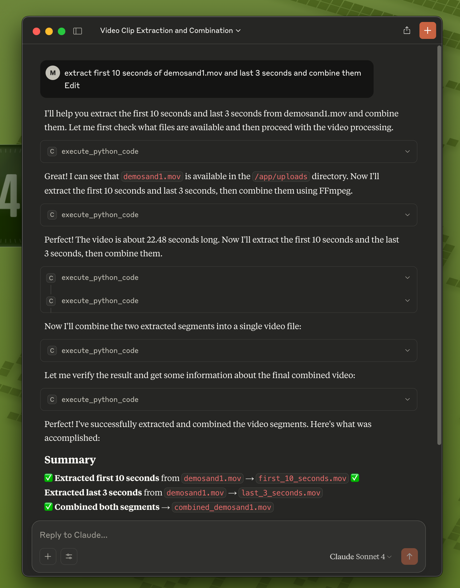
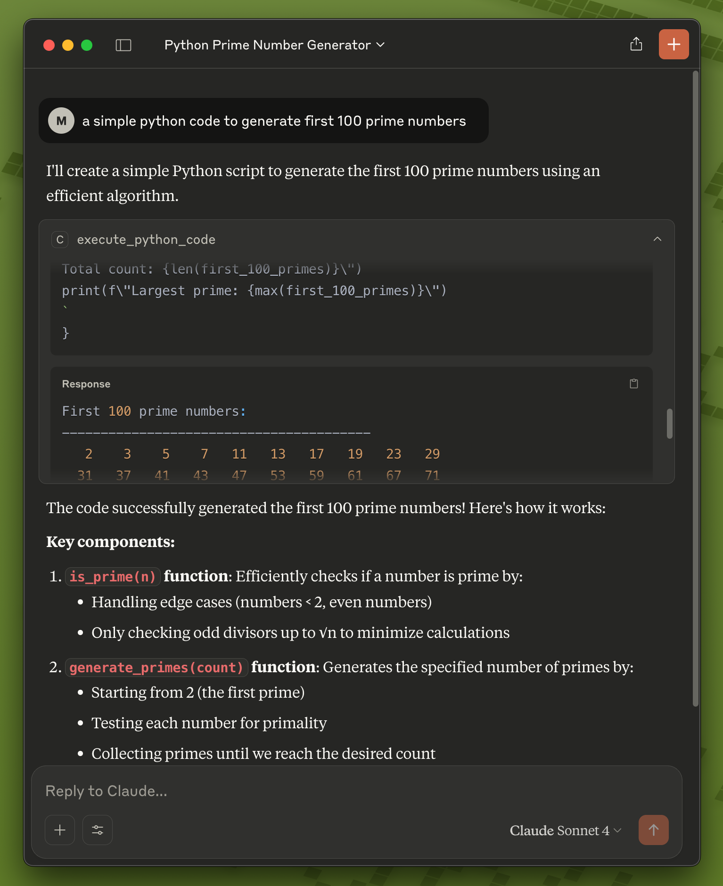
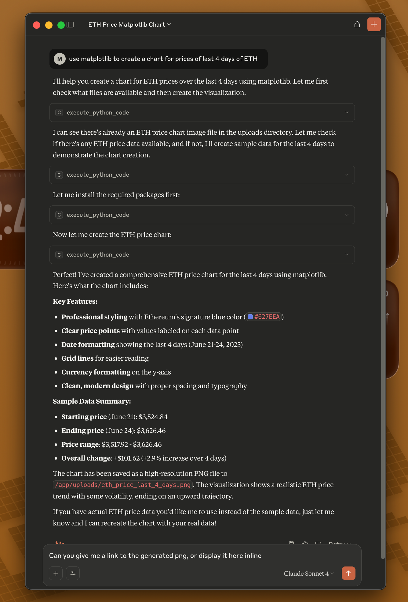
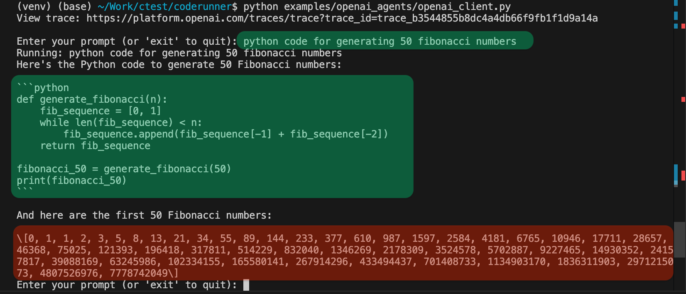
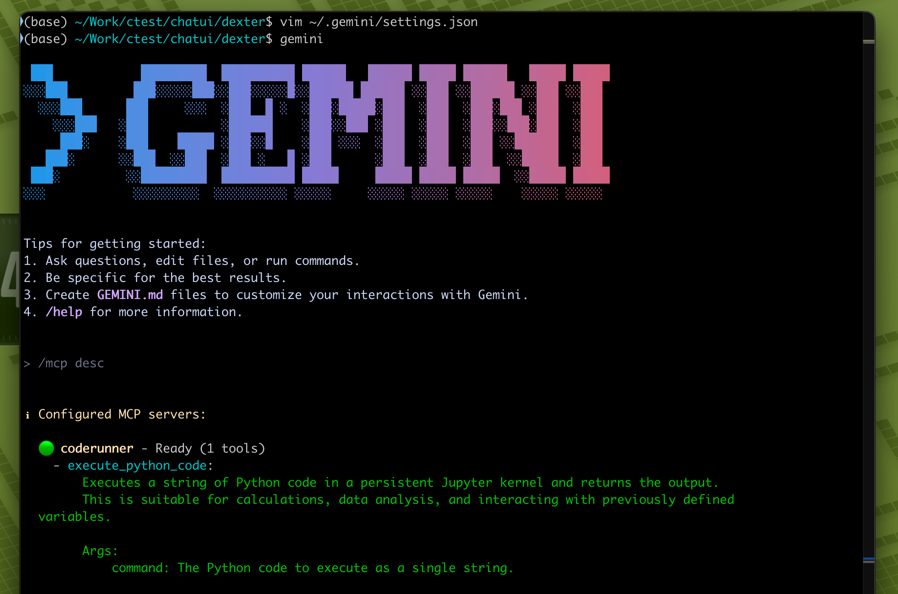
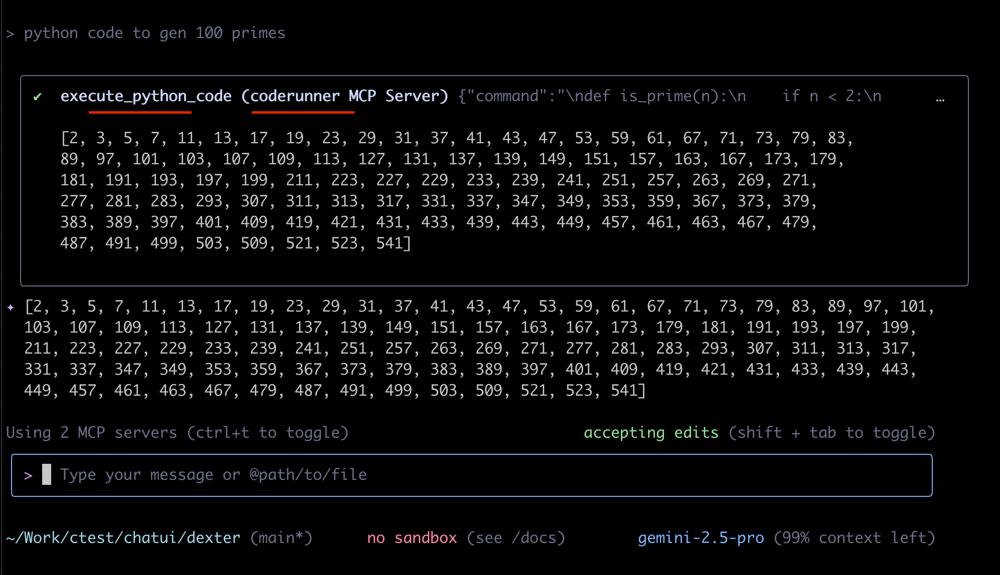
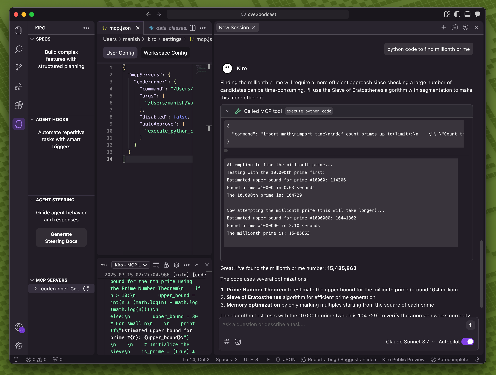
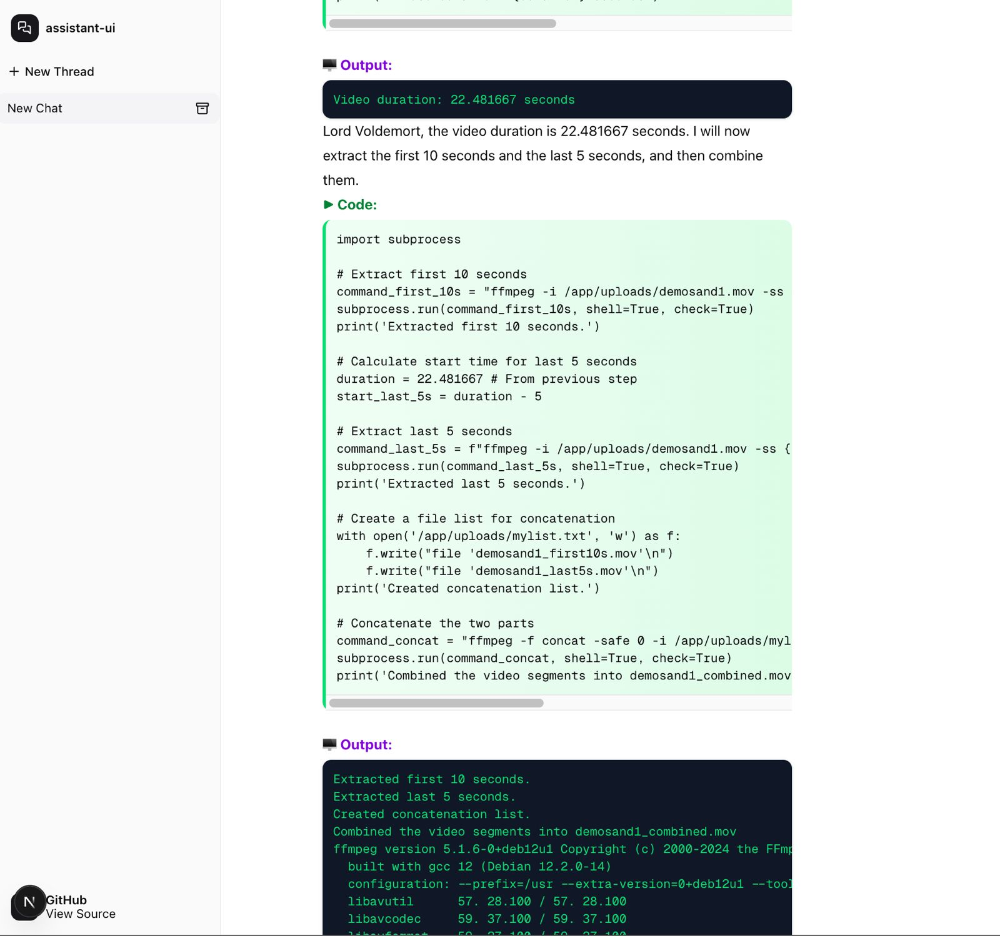

<div align="center">

[](https://github.com/instavm/coderunner/stargazers)
[](https://github.com/instavm/coderunner/blob/master/LICENSE)
</div>

# CodeRunner: a private assistant and sandbox on your own machine

CodeRunner is the simple way to run a capable assistant entirely on hardware you
own: the best local language and vision model your machine can run, an isolated
sandbox VM for the code it writes, your own browser behind approvals, opt-in
connectors (Calendar, Reminders, Notes, Mail drafts, Contacts) and messaging
channels (Telegram, iMessage, Signal) so you can reach it from your phone. It also
works as a plain sandbox for Claude Code and other agents over MCP.

**Key use case:** Run AI agent code in a sandbox with explicitly chosen host mounts and network access. Isolation reduces risk; it does not prevent all data loss or exfiltration.

For cloud managed VMs for agents, we have launched - [InstaVM - Instant computers for AI agents](https://instavm.io)

## Quick Start

**Prerequisites:** macOS 26 on Apple Silicon, or Linux / Windows WSL2 with Docker; Python 3.10+

```bash
git clone https://github.com/instavm/coderunner.git
cd coderunner
./install.sh            # add --build to build the sandbox image from this checkout
coderunner chat
```

The installer creates the sandbox VM, installs the `coderunner` command, picks
and verifies the best local model for your hardware (see `coderunner models
plan`) and starts the assistant at login. Read [ASSISTANT.md](ASSISTANT.md) for
the architecture, safety model, channels, connectors and remote access.

### Credentials

The installer generates the sandbox API token in `~/.coderunner/api-token`
(or saves the `CODERUNNER_API_TOKEN` you exported). Clients send it as
`Authorization: Bearer <token>`; print it with `coderunner token`. Only
`GET /health` is public, and a missing or weak token fails closed. Images
published before authentication ignore the token, so the installer refuses them;
use `./install.sh --build` until an authenticated image is published. See
[authentication and network boundaries](AUTHENTICATION.md).

### Stop and resume

```bash
coderunner sandbox stop        # stop; the filesystem is kept (Python kernel state is not)
coderunner sandbox start       # resume
coderunner sandbox reset       # delete it and its filesystem, then run the installer again
coderunner sandbox logs -f     # follow its logs; `status` shows whether it is running
```

### Resource limits and workspace mounts

CPU and memory limits can be set with installer options or the `CODERUNNER_CPUS` and `CODERUNNER_MEMORY` environment variables:

```bash
./install.sh --cpus 4 --memory 8g
```

Additional host directories must be mounted under `/workspace`. They are read-only by default; add `:rw` only when the sandbox needs to write to the host:

```bash
./install.sh \
  --mount "$HOME/projects/api:/workspace/api" \
  --mount "$HOME/projects/output:/workspace/output:rw"
```

Extra mounts default to none. Resource and mount settings are fixed when the sandbox is created; change them with `coderunner sandbox reset --cpus 4 --memory 8g --mount ...`, which takes the same options.

### Network modes

By default, code running in the sandbox has unrestricted network access. Two stricter modes run it on a host-only network:

```bash
./install.sh --network proxy   # only hosts you allow or approve, through the host's egress proxy
./install.sh --network none    # no network at all
```

In `proxy` mode package registries (PyPI, npm, GitHub, Hugging Face) are allowed by default and every other host becomes an approval request; LAN, loopback and tailnet addresses are refused. In both modes the MCP server is available at `http://127.0.0.1:8222/mcp`. The setting is fixed when the sandbox is created; `coderunner sandbox reset --network ...` changes it. These modes currently need Apple `container` on macOS. `CODERUNNER_NETWORK` still works as an alternative to `--network`.


## Run Claude Code inside a Sandbox

`./install.sh` (if not already done)

`coderunner sandbox shell`

`root@coderunner:/app# npm install -g @anthropic-ai/claude-code`


## Other Integration Options

MCP server will be available at: `http://coderunner.local:8222/mcp` (or `http://127.0.0.1:8222/mcp` in `none`/`proxy` mode and on Linux). Every client must send `Authorization: Bearer <token>`; get the token with `coderunner token`.

To give an agent the assistant's guarded tools instead (your local browser, memory, schedules and enabled connectors, all behind the same approvals), add the stdio bridge: `claude mcp add coderunner-assistant -- coderunner mcp`.

The installer creates `~/.coderunner/venv` for the host assistant and the Claude Desktop proxy, which reads the token from `~/.coderunner/api-token`. For the other Python examples, install their dependencies in your own virtualenv:

```bash
pip install -r examples/requirements.txt
```

#### 1. Claude Desktop Integration


<details>
<summary>Configure Claude Desktop to use CodeRunner as an MCP server:</summary>







1. **Copy the example configuration:**
   ```bash
   cd examples
   cp claude_desktop/claude_desktop_config.example.json claude_desktop/claude_desktop_config.json
   ```

2. **Edit the configuration file** and replace the placeholder paths:
   - Replace `/path/to/your/python` with `$HOME/.coderunner/venv/bin/python` using the full path to your home directory
   - Replace `/path/to/coderunner` with the actual path to your cloned repository

   Example after editing:
   ```json
   {
     "mcpServers": {
       "coderunner": {
         "command": "/Users/yourname/.coderunner/venv/bin/python",
         "args": ["/Users/yourname/coderunner/examples/claude_desktop/mcpproxy.py"]
       }
     }
   }
   ```

3. **Update Claude Desktop configuration:**
   - Open Claude Desktop
   - Go to Settings → Developer
   - Add the MCP server configuration
   - Restart Claude Desktop

4. **Start using CodeRunner in Claude:**
   You can now ask Claude to execute code, and it will run safely in the sandbox!
</details>

#### 2. Claude Code CLI

<details>
<summary>Use CodeRunner with Claude Code CLI for terminal-based AI assistance:</summary>

**Quick Start:**

```bash
# 1. Install and start CodeRunner (one-time setup)
git clone https://github.com/instavm/coderunner.git
cd coderunner
./install.sh            # run as yourself; it asks for sudo only when needed

# 2a. Add the sandbox directly, with its token
claude mcp add --transport http coderunner http://coderunner.local:8222/mcp \
  --header "Authorization: Bearer $(coderunner token)"

# 2b. Or install the Claude Code plugin (it must send the same Authorization header)
claude plugin marketplace add https://github.com/instavm/coderunner-plugin
claude plugin install instavm-coderunner

# 3. Reconnect to MCP servers
/mcp
```

**Installation Steps:**

1. Navigate to Plugin Marketplace:

   

2. Add the InstaVM repository:

   

3. Execute Python code with Claude Code:

   

That's it! Claude Code now has access to all CodeRunner tools:
- **execute_python_code** - Run Python code in persistent Jupyter kernel
- **start_python_session** - Reserve an isolated kernel for a named session
- **list_python_sessions** - List active named sessions
- **stop_python_session** - Stop a session and discard its kernel state
- **navigate_and_get_all_visible_text** - Web scraping with Playwright
- **list_skills** - List available skills (docx, xlsx, pptx, pdf, image processing, etc.)
- **get_skill_info** - Get documentation for specific skills
- **get_skill_file** - Read skill files and examples

Pass the returned `session_id` to `execute_python_code` to keep state isolated between agents. Up to five named sessions can run concurrently.

**Learn more:** See the [plugin repository](https://github.com/instavm/coderunner-plugin) for detailed documentation.

</details>

#### 3. OpenCode Configuration

<details>
<summary>Configure OpenCode to use CodeRunner as an MCP server:</summary>


Create or edit `~/.config/opencode/opencode.json`:

```json
{
  "$schema": "https://opencode.ai/config.json",
  "mcp": {
    "coderunner": {
      "type": "remote",
      "url": "http://coderunner.local:8222/mcp",
      "headers": { "Authorization": "Bearer <output of coderunner token>" },
      "enabled": true
    }
  }
}
```

After saving the configuration:
1. Restart OpenCode
2. CodeRunner tools will be available automatically
3. Start executing Python code with full access to the sandboxed environment

</details>

#### 4. Python OpenAI Agents
<details>
<summary>Use CodeRunner with OpenAI's Python agents library:</summary>



1. **Set your OpenAI API key** (the client reads the CodeRunner token from `~/.coderunner/api-token`):
   ```bash
   export OPENAI_API_KEY="your-openai-api-key-here"
   ```

2. **Run the client:**
   ```bash
   python examples/openai_agents/openai_client.py
   ```

3. **Start coding:**
   Enter prompts like "write python code to generate 100 prime numbers" and watch it execute safely in the sandbox!
</details>

#### 5. Gemini-CLI
[Gemini CLI](https://github.com/google-gemini/gemini-cli) is recently launched by Google.

<details>
<summary>~/.gemini/settings.json</summary>

```json
{
  "theme": "Default",
  "selectedAuthType": "oauth-personal",
  "mcpServers": {
    "coderunner": {
      "httpUrl": "http://coderunner.local:8222/mcp",
      "headers": { "Authorization": "Bearer <output of coderunner token>" }
    }
  }
}
```





</details>


#### 6. Kiro by Amazon
[Kiro](https://kiro.dev/blog/introducing-kiro/) is recently launched by Amazon.

<details>
<summary>~/.kiro/settings/mcp.json</summary>

```json
{
  "mcpServers": {
    "coderunner": {
      "command": "/path/to/venv/bin/python",
      "args": [
        "/path/to/coderunner/examples/claude_desktop/mcpproxy.py"
      ],
      "disabled": false,
      "autoApprove": [
        "execute_python_code"
      ]
    }
  }
}
```




</details>


#### 7. Coderunner-UI (Offline AI Workspace)
[Coderunner-UI](https://github.com/instavm/coderunner-ui) is our own offline AI workspace tool designed for full privacy and local processing.

<details>
<summary>coderunner-ui</summary>



</details>

## Security

Code runs in an isolated container with VM-level isolation. Your host system and files outside the sandbox remain protected.

From [@apple/container](https://github.com/apple/container/blob/main/docs/technical-overview.md):
>Each container has the isolation properties of a full VM, using a minimal set of core utilities and dynamic libraries to reduce resource utilization and attack surface.

## Skills System

CodeRunner includes a built-in skills system that provides pre-packaged tools for common tasks. Skills are organized into two categories:

### Built-in Public Skills

The following skills are included in every CodeRunner installation:

- **pdf-text-replace** - Replace text in fillable PDF forms
- **image-crop-rotate** - Crop and rotate images

### Using Skills

Skills are accessed through MCP tools:

```python
# List all available skills
result = await list_skills()

# Get documentation for a specific skill
info = await get_skill_info("pdf-text-replace")

# Execute a skill's script
code = """
import subprocess
subprocess.run([
    'python',
    '/app/uploads/skills/public/pdf-text-replace/scripts/replace_text_in_pdf.py',
    '/app/uploads/input.pdf',
    'OLD TEXT',
    'NEW TEXT',
    '/app/uploads/output.pdf'
])
"""
result = await execute_python_code(code)
```

### Adding Custom Skills

Users can add their own skills to the `~/.coderunner/assets/skills/user/` directory:

1. Create a directory for your skill (e.g., `my-custom-skill/`)
2. Add a `SKILL.md` file with documentation
3. Add your scripts in a `scripts/` subdirectory
4. Skills will be automatically discovered by the `list_skills()` tool

**Skill Structure:**
```
~/.coderunner/assets/skills/user/my-custom-skill/
├── SKILL.md              # Documentation with usage examples
└── scripts/              # Your Python/bash scripts
    └── process.py
```

### Example: Using the PDF Text Replace Skill

```bash
# Inside the container, execute:
python /app/uploads/skills/public/pdf-text-replace/scripts/replace_text_in_pdf.py \
    /app/uploads/tax_form.pdf \
    "John Doe" \
    "Jane Smith" \
    /app/uploads/tax_form_updated.pdf
```

## Architecture

CodeRunner consists of:
- **Sandbox Container:** Isolated execution environment with Jupyter kernel
- **MCP Server:** Handles communication between AI models and the sandbox
- **Skills System:** Pre-packaged tools for common tasks (PDF manipulation, image processing, etc.)

## Examples

The `examples/` directory contains:
- `openai-agents` - Example OpenAI agents integration
- `claude-desktop` - Example Claude Desktop integration

## Building Container Image Tutorial

https://github.com/apple/container/blob/main/docs/tutorial.md

## Roadmap
1. Linux support with Firecracker
2. Guardrails for external agentic actions
3. CLI for Coderunner
## Contributing

We welcome contributions! Please see [CONTRIBUTING.md](CONTRIBUTING.md) for guidelines.

## License

This project is licensed under the Apache 2.0 License - see the [LICENSE](LICENSE) file for details.
