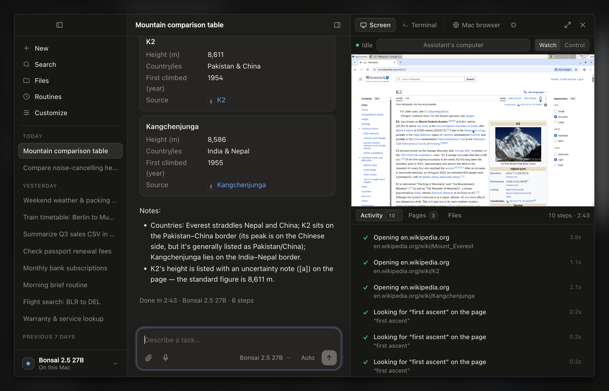
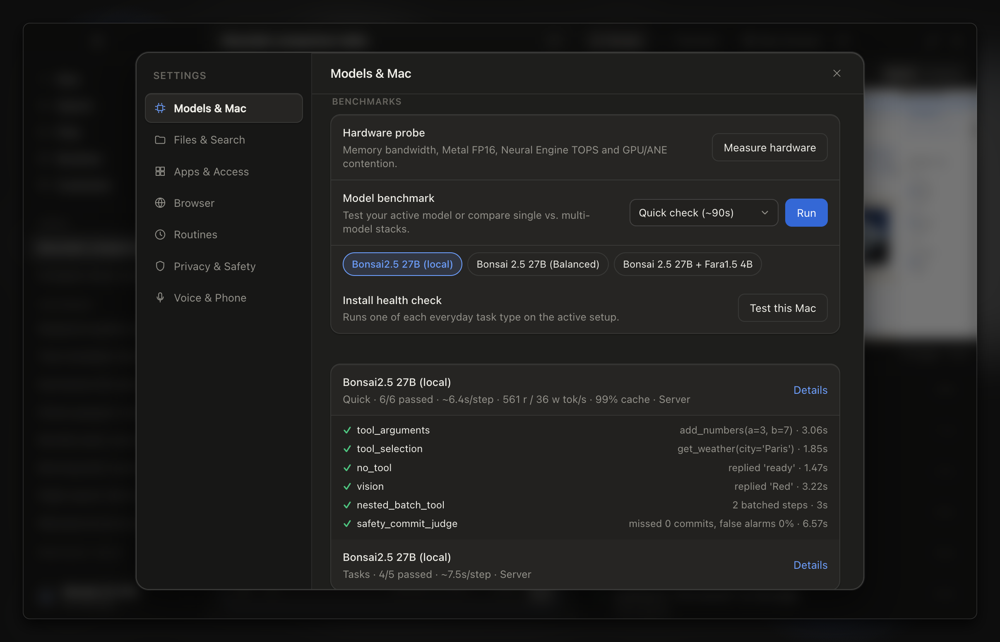
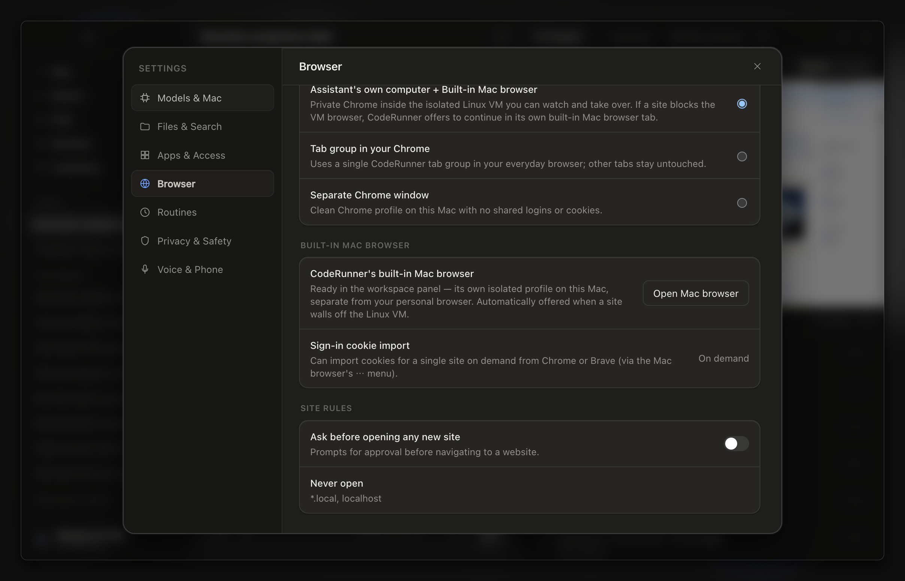

<div align="center">

[](https://github.com/instavm/coderunner/stargazers)
[](LICENSE)

</div>

# CodeRunner

A local desktop assistant with its own isolated Linux computer, a built-in Mac browser, and an on-device file search index for your Mac — running on local models, your own model server, or an API key.

CodeRunner runs tasks inside a VM-isolated Linux sandbox you can watch and take over live, indexes the folders and Mac apps you choose on the Neural Engine without uploading your disk, and exposes both the search index and the sandbox over MCP to Claude Code, Codex, and Claude Desktop.



## Quick start

### Full desktop assistant (macOS 26 on Apple silicon, or Linux with Docker)

```bash
git clone https://github.com/instavm/coderunner.git && cd coderunner
./install.sh            # add --build to build the sandbox image locally
coderunner app
```

No separate model runtime is required. On macOS, setup probes your chip, unified memory, GPU bandwidth, and Neural Engine, fetches `llama.cpp` and Core ML embeddings automatically, verifies free disk space before downloading weights, smoke-tests tool calls and vision, and opens the desktop app.

### On-device search only (for Claude Code, Codex, or Claude Desktop)

```bash
git clone https://github.com/instavm/coderunner.git && cd coderunner
./install.sh --search                       # embedding model and index only (~1.5 GB)
coderunner files add ~/Documents            # share specific folders
coderunner files sources add mail           # optional: mail, messages, notes, calendar
claude mcp add coderunner-search -- coderunner mcp --tools search
```

Works on Apple silicon macOS 15+ (embeddings run on the Neural Engine via Core ML) or Linux with Ollama. Codex: `codex mcp add coderunner-search -- coderunner mcp --tools search`. Terminal search: `coderunner find "apartment lease notice period"`.

## What is in v2

### Desktop workspace
- **Three-lane layout**: task history and search on the left, conversational thread in the center, and the assistant's workspace on the right.
- **Top-pinned live screen + Workspace Companion Deck**: the sandbox VNC display stays pinned to the top at its native aspect ratio; the companion deck directly below shows the live step-by-step **Activity** timeline (with durations, plan progress, adaptive pivots, and an **Answer now** wrap control), deduplicated **Pages** visited, and thread **Files**.
- **Terminal & Built-in Mac browser**: switch tabs in the workspace panel to drop into the sandbox VM's PTY (`Terminal`), watch or take over CodeRunner's isolated **Mac browser**, or inspect active models and memory pressure.
- **Routines, dictation, and attachments**: attach PDFs, receipts, spreadsheets, audio, or video directly in the composer; dictate locally with Parakeet Core ML, Apple Speech, or Qwen3-ASR; schedule recurring routines from chat or Settings.

### Local models, hardware probing & benchmarks



- **Tiered Apple Silicon planning (8–512 GB unified RAM)**: measures real GPU bandwidth, Metal FP16 throughput, and Core ML Neural Engine TOPS (`Measure hardware` / `coderunner models bench`) instead of relying on spec-sheet guesses.
- **Built-in Benchmark Lab**: run a 90-second capability & safety gate (tool arguments, nested `browser_batch`, vision, KV cache-hit ratio, and stratified commit-judge accuracy) or multi-domain end-to-end tasks directly from **Settings → Models & Mac**.
- **Run where you want**: run entirely on your Mac, point at your own OpenAI-compatible model server (e.g. `llama-server` over Tailscale), or switch to Claude with your own Anthropic API key (`coderunner claude on` — clearly marked as non-private whenever active).
- **Resilient local-model loop**: detects silent dead pages (404s, bot walls, bad redirects) and pivots strategy dynamically, breaks stalled plan loops, escalates compaction cleanly on 32K contexts, groups independent page opens with tab-aware queries, and runs a single append-only verification pass before replying.

### Browser & safety boundaries



- **Sandboxed browsing + Built-in Mac browser**: by default the assistant browses inside Chrome in the isolated Linux VM. If a site blocks the VM with a bot check, CodeRunner asks once to continue in its own isolated **Mac browser** tab (separate from your personal browser, with optional single-site cookie import).
- **Approval policy & commit judge**: reading pages and filling search forms run without interruption; actions that pay, book, send, post, delete, or change settings require explicit approval. Passwords, 2FA codes, and CAPTCHAs are never typed by the model — it pauses and hands the screen over to you.
- **Untrusted content isolation**: web pages, mail, and sandbox outputs are delimited as untrusted data and taint the run so subsequent sensitive actions or cross-site data sharing require fresh approval.

## Private search for external agents

Agents connected via `coderunner mcp --tools search` get `files_search`, `file_read`, `file_view`, `file_listen`, `memory_search`, and `memory_save`:

- Hybrid semantic + keyword retrieval across documents, PDFs, notes, code, spreadsheets, screenshots (on-device OCR), photos, video frames, and audio. On the reproducible benchmark corpus: **94.4% R@1** and **19 ms** median query latency ([VALIDATION.md](VALIDATION.md)).
- Secrets, private keys, `.env` files, hidden folders, and `~/Library` are never indexed. One-time codes and sign-in links are redacted from indexed mail.
- Small iCloud-only files can be downloaded briefly to index and evicted back to iCloud.

## The sandbox VM

Code executes inside an isolated Linux VM (Apple `container` on macOS 26, Docker elsewhere) with an authenticated MCP server and persistent `/workspace` storage.

### Lifecycle

```bash
coderunner sandbox stop        # stop VM; filesystem is preserved
coderunner sandbox start       # start VM
coderunner sandbox reset       # recreate VM and filesystem
coderunner sandbox status      # inspect health and disk usage
coderunner sandbox logs -f     # stream VM logs
```

### Resource limits, mounts & network modes

```bash
./install.sh --cpus 4 --memory 8g \
  --mount "$HOME/projects/api:/workspace/api" \
  --mount "$HOME/projects/output:/workspace/output:rw"

./install.sh --network proxy   # only approved hosts via the host egress proxy (blocks LAN/loopback/tailnet)
./install.sh --network none    # offline sandbox
```

Extra mounts default to read-only unless suffixed with `:rw`. Change resource, mount, or network settings with `coderunner sandbox reset` using the same flags.

### Connecting MCP clients to the sandbox

The sandbox MCP server listens at `http://coderunner.local:8222/mcp` (`http://127.0.0.1:8222/mcp` in `proxy`/`none` modes and on Linux). Every endpoint except `GET /health` requires `Authorization: Bearer <token>` (`coderunner token` prints the generated token in `~/.coderunner/api-token`).

```bash
# Claude Code
claude mcp add --transport http coderunner http://coderunner.local:8222/mcp \
  --header "Authorization: Bearer $(coderunner token)"
```

```json
// Gemini CLI (~/.gemini/settings.json) or OpenCode (~/.config/opencode/opencode.json)
{
  "mcpServers": {
    "coderunner": {
      "httpUrl": "http://coderunner.local:8222/mcp",
      "headers": {
        "Authorization": "Bearer <output of coderunner token>"
      }
    }
  }
}
```

For Claude Desktop and Kiro, point them at the stdio bridge in `examples/claude_desktop/mcpproxy.py` using `~/.coderunner/venv/bin/python` (see `examples/claude_desktop/claude_desktop_config.example.json`). For managed cloud VMs, see [InstaVM](https://instavm.io).

### Skills

Skills live in folders containing a `SKILL.md` and scripts under `~/.coderunner/assets/skills/user/<name>/` and are exposed through `list_skills`, `get_skill_info`, and `get_skill_file`. Two built-in skills ship by default (`pdf-text-replace` and `image-crop-rotate`). See [SKILLS-README.md](SKILLS-README.md).

## Documentation

- [ASSISTANT.md](ASSISTANT.md) — full architecture, safety model, model tiers, and CLI reference
- [VALIDATION.md](VALIDATION.md) — automated test coverage and measured benchmark runs
- [AUTHENTICATION.md](AUTHENTICATION.md) — bearer token handling and network boundaries
- [THREAT_MODEL.md](THREAT_MODEL.md) — sandbox isolation guarantees and limits
- [CONTRIBUTING.md](CONTRIBUTING.md) — development setup and contribution guidelines

## License

Apache 2.0 — see [LICENSE](LICENSE).
