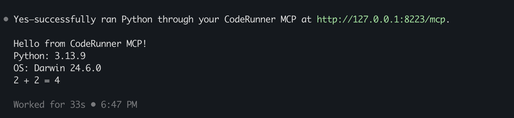

# Experimental macOS guest backend

CodeRunner's Linux backend uses Apple's `container` CLI. macOS needs a full guest
OS, so this backend uses [Tart](https://tart.run/) and Apple's
[Virtualization framework](https://developer.apple.com/documentation/virtualization/virtualize-macos-on-a-mac).
The server, Jupyter kernels and Playwright run **inside the guest**. The host only
runs Tart and an SSH tunnel. This is macOS on a physical Mac, not another layer of
nested virtualization inside a VM.



Python execution through the guest's MCP endpoint at `http://127.0.0.1:8223/mcp`.

## Requirements

- Apple silicon Mac, macOS 13 or newer, Python 3.10+, OpenSSH, Tart 2.41+.
- At least 50 GiB free disk space. The default image has a 50 GB sparse disk and
  a roughly 25 GB compressed download; physical allocation grows during the pull
  and guest provisioning. Leave additional room for your workloads.
- 4 GiB available guest RAM; defaults are 2 CPUs and 4096 MiB RAM.
- A trusted Tart macOS image with a user account, SSH
  enabled, and passwordless sudo. Cirrus Labs base images provide this setup.
  Arbitrary IPSW files and unattended first installation are not supported here.

Install Tart following its [official instructions](https://tart.run/quick-start/).
Tart is an external dependency with its own license. Review its current terms
before distributing a commercial service. Apple's macOS license permits certain
local development/testing VMs on Apple hardware; cloud hosting is a separate
licensing question. This backend is a local development experiment.

## Create and run

From the repository root:

```bash
./install.sh --guest macos create
./install.sh --guest macos start
./install.sh --guest macos smoke
```

The default is a digest-pinned `ghcr.io/cirruslabs/macos-sequoia-base` image
(see `DEFAULT_IMAGE` in `macos_vm.py`). To select a different image, use `create --image ghcr.io/cirruslabs/IMAGE@sha256:DIGEST` or a trusted
local image in this backend's Tart storage. Use `create --download-concurrency 16` to increase parallel transfers on fast links.
Image provenance matters: code and
credentials inside a prebuilt guest are controlled by its publisher.

`start` copies only the server, authentication module, macOS runtime scripts and
public skills into the guest, installs Python 3.13.9 with hash-locked packages and
Chromium, and registers a guest LaunchDaemon running as the guest user. No host directories are mounted.
The initial image login uses `admin` / `admin`; set `create --user USER` and
`CODERUNNER_GUEST_PASSWORD` for a different image. Provisioning installs a unique
SSH key and replaces the account's default password with a random password.
It requires the image's passwordless sudo for the account change and service registration.

The endpoint is `http://127.0.0.1:8223/mcp`, separate from Linux's port 8222.
Use the bearer token from `~/.coderunner/macos/coderunner-macos/api-token`.
The SSH key, token, rotated guest password, pinned SSH host key, logs and VM
configuration live under that private state directory. Tokens are not printed.

```bash
# Existing REST clients work unchanged except for URL and token.
export CODERUNNER_API_TOKEN="$(cat ~/.coderunner/macos/coderunner-macos/api-token)"
curl http://127.0.0.1:8223/execute \
  -H "Authorization: Bearer $CODERUNNER_API_TOKEN" \
  -H 'Content-Type: application/json' \
  -d '{"code":"import platform; print(platform.mac_ver())"}'

./install.sh --guest macos ssh sw_vers
./install.sh --guest macos status
./install.sh --guest macos stop
./install.sh --guest macos start
```

Use `stop` followed by `start --gui` to display the macOS guest window. The rotated
guest login password is in the private `guest-password` file.

Guest files survive stop/start; Python kernel memory does not. `start --provision`
updates the guest with the current checkout. Each VM operation is locked against
concurrent invocations. A failed provisioning attempt can be retried with `start`.
A VM that fails to start has details in its host-side `vm.log`.

Global options precede the subcommand:

```bash
./install.sh --guest macos --name test-mac --state-dir /path/with/space create \
  --cpus 2 --memory 4096 --port 8224
```

`CODERUNNER_MACOS_HOME` sets the state root; `CODERUNNER_TART` sets the Tart binary
path. The backend uses its own `TART_HOME` under the state root and disables Tart's
automatic pruning so it does not delete other images to make room.

## Network and runtime boundaries

All three guest services bind to 127.0.0.1. SSH forwards only guest port 8222 to
host 127.0.0.1:8223. Authentication and host/origin validation are unchanged.
Clipboard, audio and USB sharing are disabled. There are no default host mounts.

NAT networking allows guest internet and host/LAN access. After initial online
provisioning, use host-only networking if the workload should have no internet:

```bash
./install.sh --guest macos stop
./install.sh --guest macos start --network none
# To restore internet access:
./install.sh --guest macos stop
./install.sh --guest macos start --network nat
```

Network selection persists across subsequent starts. Host-only networking still
allows access to the host. A running guest must be stopped to change modes.
Provisioning requires internet. Do not treat this pilot as hardened multitenant
isolation: sandbox code runs as the guest's desktop user with passwordless sudo,
and can affect its guest OS, local service credentials and other sessions.

The macOS dependency set supports Python/Bash kernels, REST/MCP, files, skills and
Chromium. It does not promise all the Linux image's scientific packages, PDF
utilities, systemd, apt packages, or Linux filesystem paths. Install additional
packages inside the guest as required. Desktop computer-use automation is not
added by this backend.

## Tests and troubleshooting

```bash
python3 -m unittest discover -s tests -p test_macos_vm.py -v
./install.sh --guest macos smoke
./install.sh --guest macos ssh tail -80 .coderunner/logs/server.log
```

The live smoke test checks that unauthenticated execution returns 401, then calls
`/execute` and requires Darwin plus `kern.hv_vmm_present=1`, proving execution
inside a macOS VM rather than on the host.

Python's standalone archive is fetched with macOS `curl` and verified against
the SHA-256 from [uv's pinned download metadata](https://github.com/astral-sh/uv/blob/0.9.9/crates/uv-python/download-metadata.json)
before installation through a local uv mirror. This avoids a GitHub TLS handshake
failure observed with uv's HTTP client without disabling certificate verification.

The SSH host key is accepted on first use and pinned per VM; later changes fail
closed. Only remove that VM's `known_hosts` file when deliberately replacing it.
To remove a test VM, stop it, then run `TART_HOME=STATE_ROOT/tart tart delete NAME`.
Remove its state directory separately if you also want to discard its credentials.
